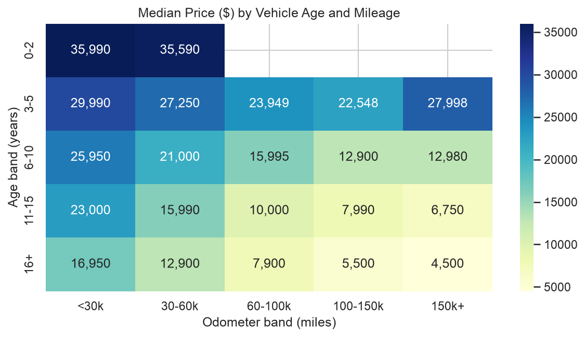
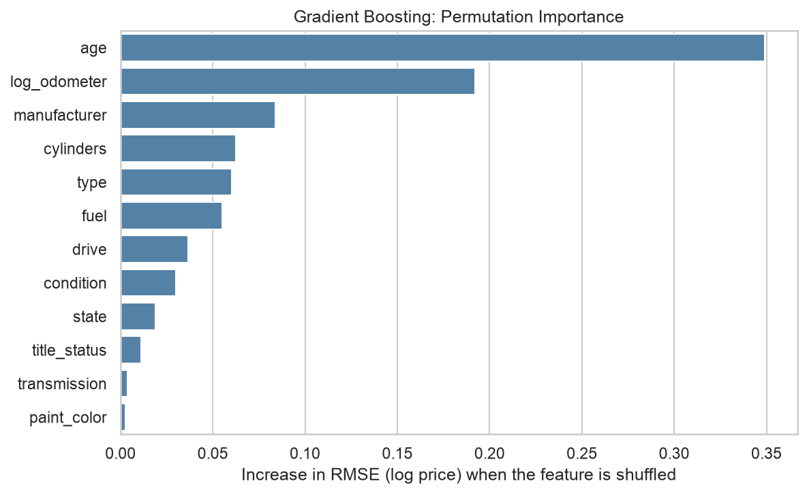
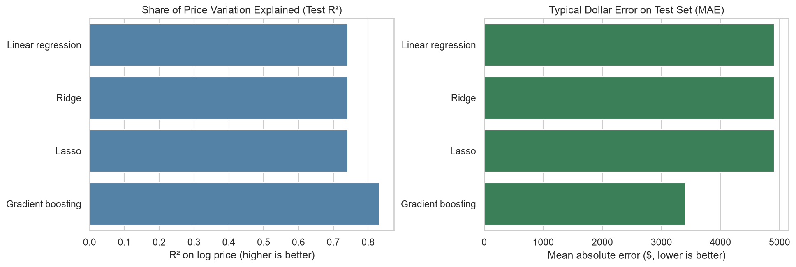

# Project Price Used Car Analytics (PUCA)
berkley_haas_module11_usedcar

What drives the price of a used car? This project analyzes about 427,000 Craigslist used-vehicle listings (Kaggle) and gives a used car dealership clear guidance on what buyers value.

**Notebook:** [used_car_price_analysis.ipynb](used_car_price_analysis.ipynb) (follows the CRISP-DM framework, from business understanding through findings)

## Summary of findings

* **Best model:** gradient boosting explains about **83%** of price variation on held-out data (R² on log price) and misses by a typical **$3,400**. Linear, Ridge and Lasso regression reach about 74% and miss by about $4,900.
* **Age and mileage matter most.** Each additional ~6 years of age is associated with about 35% lower price, and high mileage cuts price sharply (for 6-10 year-old cars, the median falls from about $26,000 under 30k miles to about $13,000 over 100k miles).
* **Next most important:** manufacturer, engine size, body type and fuel. Premium brands (Porsche, Tesla, Lexus) and diesel vehicles carry large premiums.
* **Condition and title status:** salvage or fair condition is associated with about 35% lower prices, and a missing title record with about 35% lower prices.
* **Little effect:** paint color and transmission.

### Key figures







All figures generated by the notebook are saved in [`images/`](images/).

### Recommendations
1. Favor younger, lower-mileage inventory; cars 6-10 years old with under 60,000 miles are a strong value sweet spot.
2. Stock premium brands and diesel trucks/SUVs for higher ticket prices, while watching turnover.
3. Avoid or heavily discount salvage, rebuilt and unclear-title vehicles.
4. Record condition, cylinders and drive type in every listing.
5. Don't pay a premium for paint color or transmission.

Caveats: prices are asking prices (not sale prices), and the results show association, not cause.

## Repository contents

| Path | Description |
|---|---|
| `used_car_price_analysis.ipynb` | Full analysis: cleaning, exploration, modeling, evaluation, findings |
| `images/` | PNG files of every figure produced by the notebook |
| `data/vehicles.csv.zip` | Source data (read directly by pandas) |

## How to run

```bash
pip install pandas numpy scikit-learn matplotlib seaborn scipy jupyter
jupyter notebook used_car_price_analysis.ipynb
```
